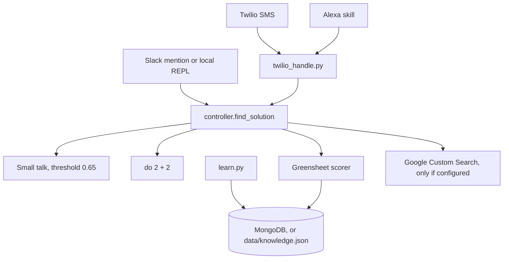
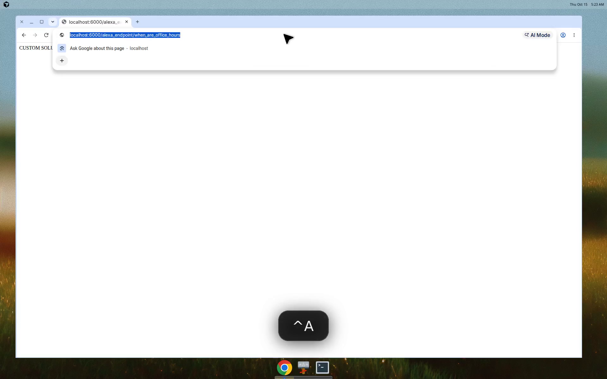

# Spartanbot

Spartanbot answers questions about the San Jose State University **CMPE 273** greensheet. It was a class project for **CMPE 273 Section 1, Enterprise Distributed Systems, Spring 2017**, taught by Sithu Aung. The group (from the git history) was Pranav Prem, Foram Mehta, Tushar Rajput, and Noopur Joshi. It is not an internship project.

The course handout, `cmpe273-greensheet.docx`, is the knowledge source: instructor, office hours, classroom, outcomes, schedule, grading, and policies. The bot was meant to cover as much of that sheet as possible, then fill gaps with other systems the group tried that semester: IBM Watson Natural Language Classifier, ChatterBot, and Google Custom Search. Slack was the main interface. Twilio could drop an SMS into the Slack channel, and an Alexa skill called an HTTP endpoint on Heroku.

Those hosted pieces are mostly gone. The answer pipeline still runs on Python 3.12 with no accounts required.

## How it works



1. `learn.py` reads `subjects.txt`, `objects.txt`, and the greensheet. Tables become sentences such as `Instructor for CMPE273 is Sithu Aung`. Paragraphs that start with `:` drop the colons. A ` ** ` marker becomes the word "is".
2. The sentence engine lowercases the text, lemmatizes tokens with NLTK, and keeps two kinds of keywords. Subjects (proper-noun style terms such as `CMPE273` or `Sithu`) match as substrings. Objects (attributes such as `office` or `instructor`) match as tokens, and WordNet's first sense adds synonyms.
3. A question goes through the same engine. Each stored sentence is scored as the size of the keyword overlap divided by the **longer** keyword list, times 100. Sentences in the top quarter of that confidence range are returned, highest first. The 2017 write-up described dividing by the shorter list; the implementation has always used the longer one.
4. Before that retrieval, a small-talk chain answers greetings, and `do <int> <op> <int>` does arithmetic. Replying `no` asks you to type a better answer, and the next message is stored.

The original architecture drawing is still in [`Untitled Diagram.xml`](Untitled%20Diagram.xml) (draw.io). The photos that used to be on `pranavprem.com/spartabot/` no longer load, so they are not embedded here.

There is no graphical UI. Slack, SMS, Alexa, and a terminal REPL are the interfaces. A local session after `python learn.py` looks like this (the process also prints the command and the remember-mode flag to stdout):

```text
> how are you?
I am good.Thankyou.

> do 7 * 6
result is 42
Are you satisfied with that response?

> who is the instructor
CUSTOM SOLUTION ::
Instructor for CMPE273 is Sithu Aung
Additionally, this might help:
Are you satisfied with that response?

> when are office hours
CUSTOM SOLUTION ::
Office Hours for Sithu Aung is Wednesday 5:00pm to 6:00pm by Appointment Only
Office Location for Sithu Aung is ENG 281
Additionally, this might help:
Are you satisfied with that response?

> where is the classroom
CUSTOM SOLUTION ::
Classroom for CMPE273 is DMH 227
Additionally, this might help:
Are you satisfied with that response?
```

`Additionally, this might help:` stays empty unless Google Custom Search returns a hit. That trailing prompt is the 2017 behavior.

The same instructor answer over HTTP, which is as close as this project gets to a UI:



## How to run it today

Requires Python 3.12.

```bash
python3 -m venv .venv
source .venv/bin/activate
pip install -r requirements.txt
python -m nltk.downloader punkt_tab wordnet omw-1.4
python learn.py
python spartanbot.py
```

`learn.py` is a one-shot load, not a worker. With no `MONGODB_URI`, it writes `data/knowledge.json`. Running it again appends the greensheet sentences a second time; keyword lists are not duplicated. `spartanbot.py` starts a REPL when Slack is not configured. `python spartanbot.py --local` forces that REPL even if tokens are set.

NLTK data is downloaded on first use when it is missing (into `./nltk_data`, or `/tmp/nltk_data` if the app directory is not writable). The committed corpus from 2017 was removed.

The HTTP app:

```bash
PORT=8080 python twilio_handle.py
```

The process defaults to port 6000, which is what the 2017 Heroku app used. Chrome blocks port 6000 as an unsafe port, so use `8080` (or any other free port) when you open the page in a browser. `curl` is fine on 6000.

- `GET /` returns `Spartanbot is running.`
- `GET /alexa_endpoint/who_is_the_instructor` returns the same answer Alexa would speak, with newlines turned into `. `.
- `POST /twilio` accepts an SMS only when `user_number` is set and the sender occurs in that string. It posts the question and the answer to Slack. The original channel name, typo included, is `#testonebotchanel`.

Heroku still uses the `Procfile` (`worker` for the Slack listener, `web` for Flask) and `.python-version` (`3.12`). `runtime.txt` used to pin Python 2.7.13; Heroku now wants `.python-version`, so the old file is gone. The 2017 app `shrouded-ocean-49421` and the mLab database `heroku_jrt9gnq3` should be treated as dead. Set `MONGODB_URI` to any current MongoDB if you want the original database path; otherwise the JSON file is the store.

### Slack

| Variable | Purpose |
| --- | --- |
| `SLACK_BOT_TOKEN` or `slacktoken` | Bot token |
| `SLACK_APP_TOKEN` | App-level token. When set with the bot token, the worker uses Socket Mode |
| `SLACK_BOT_ID` or `bot_id` | Optional. `auth.test` is used when it is unset |
| `SLACK_CHANNEL` | SMS target. Default `#testonebotchanel` |

Socket Mode is the path that works for a Slack app created now. RTM is only attempted when you have a bot token and no app token, which matches the 2017 classic-bot setup. New classic bots can no longer be created. `python findbotid.py` looks up a bot user named `testonebot` (override with `SLACK_BOT_NAME`) and never reads a token from source.

### Alexa

`Alexa Skill Lambda/service.py` is the skill handler. `python "Alexa Skill Lambda/service.py"` runs the sample `LaunchRequest` in `event.json` and answers "Yo" without calling the network. A `QuestionIntent` GETs `ALEXA_BACKEND_URL` (default `https://shrouded-ocean-49421.herokuapp.com/alexa_endpoint/`). Point that at a running `twilio_handle.py` before using the skill. The handler used to shell out through pycurl; it now uses the standard library. `config.yaml` is the old python-lambda config, with the AWS key fields left blank.

### Tests and lint

```bash
pip install -r requirements-dev.txt
ruff check .
ruff format --check .
pytest
```

GitHub Actions runs those three on Python 3.12.

Copy [`.env.example`](.env.example) to `.env` if you want local tokens. Real environment variables win over the file. Do not commit `.env`.

## Tech stack

| Piece | 2017 | Today |
| --- | --- | --- |
| Runtime | Python 2.7.13 | Python 3.12 |
| Slack | `slackclient` 1.0.5, RTM | `slack-sdk` 3.45.0, Socket Mode, RTM fallback, or a REPL |
| HTTP | Flask 0.12 | Flask 3.1.3 |
| Database | MongoDB on mLab via PyMongo 3.4 | PyMongo 4.19, or a local JSON file |
| Greensheet | `python-docx` 0.8.6 | `python-docx` 1.2.0 |
| Language | NLTK 3.2.2 and PyDictionary | NLTK 3.10.4 and WordNet |
| Small talk | ChatterBot 0.6 | The same training chain, similarity 0.65, stdlib `difflib` |
| Search | Google Custom Search via `google-api-python-client` 1.6.2 | Same API, client 2.201.0, skipped when unconfigured or the call fails |
| Classifier | Watson NLC on Bluemix | Original endpoint only, and only when credentials are set. Empty string on failure |
| SMS | Twilio webhook, SDK mostly commented out | Flask route, no Twilio SDK |
| Alexa | pycurl inside a committed virtualenv | `urllib.request` |

Pinned direct dependencies are in `requirements.txt`. Dev tools (`pytest`, `ruff`) are in `requirements-dev.txt`.

## Services that are not coming back

**Watson Natural Language Classifier** was turned off in this repo in 2017 because the Bluemix credentials had expired. IBM retired the service on 8 August 2022 and deleted remaining instances. `nlc_module.py` still knows the old `gateway.watsonplatform.net` classify URL. It returns `""` when `bluemix_username`, `bluemix_password`, and `WATSON_CLASSIFIER_ID` are missing, and it returns `""` if the call fails. The controller does not add an NLC section. Nothing here calls Natural Language Understanding or another classifier. The historical classifier id in the 2017 source was `90e7acx197-nlc-50390`. `nlc_trainer.py` can still export `training-data.csv` from the greensheet store; Watson no longer trains on it. The old trainer also read a database named `SpartanData`, which the learner never wrote, so that export was empty. It now reads the same store as everything else.

**Google Custom Search** is the API this project actually called (`customsearch` v1), aimed at `sjsu.edu` by the CSE configuration rather than by code. The search loop in the controller was commented out in 2017 to keep Alexa replies short, while the "Additionally, this might help" line stayed. The loop runs again, but a missing `my_api_key` / `my_cse_id` (aliases `GOOGLE_API_KEY` / `GOOGLE_CSE_ID`) or any API error produces no hits and the greensheet answer is unchanged. No other search backend was added.

**mLab**, the Heroku app, and Slack RTM for newly created bots are in the same category: the code path remains where it still makes sense, and local mode does not need them.

## Project structure

```text
spartanbot.py            Slack Socket Mode, RTM fallback, or local REPL
twilio_handle.py         Flask: SMS relay and /alexa_endpoint
controller.py            Order of answers: remember, small talk, math, greensheet
chatbot_solutions.py     Small-talk chain
calculator.py            do 2 + 2
sentence_engine.py       Subjects, objects, WordNet synonyms
scorer.py                Overlap score and threshold
custom_solution.py       Engine plus scorer
learn.py                 Load keyword lists and the greensheet
learner.py               Read cmpe273-greensheet.docx
db.py                    MongoDB or data/knowledge.json
db_collection.py         Store one remembered sentence
google_solution.py       Optional Custom Search
nlc_module.py            Optional retired Watson NLC call
nlc_trainer.py           Export training CSV
findbotid.py             Print a Slack bot user id
nltk_setup.py            Download punkt_tab, wordnet, omw-1.4
settings.py              Env aliases, .env loader, Slack length clip
subjects.txt             Subject keywords from the greensheet
objects.txt              Object keywords from the greensheet
cmpe273-greensheet.docx  Spring 2017 handout
Untitled Diagram.xml     Original draw.io architecture diagram
Alexa Skill Lambda/      Skill handler, sample event, python-lambda config
tests/                   Unit tests, plus one pass over the real greensheet
.github/workflows/ci.yml Lint, format, pytest
```

## Secrets

Slack bot tokens and a Bluemix password were committed in 2017. They are not in the tree anymore. They are still in git history on `master`, so rotate them in Slack and IBM Cloud even if those apps are unused. The current code reads tokens only from the environment. Do not put them back in source.
